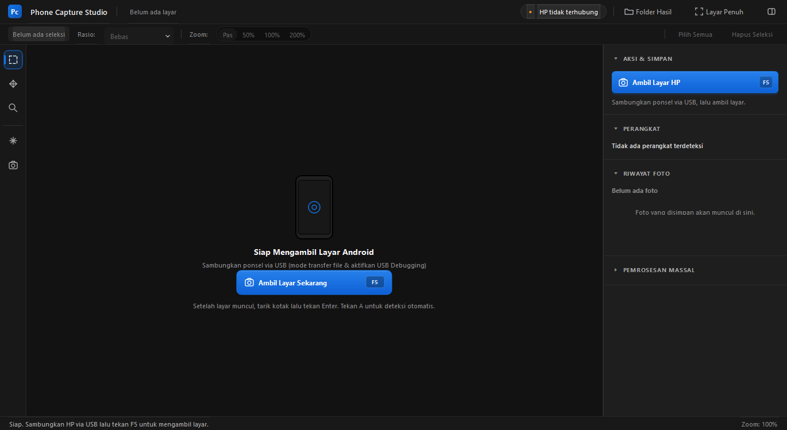

# Phone Capture Studio

Crop anything on your Android screen and save it to your PC at full resolution — over USB, in one keystroke.



Some apps let you *view* a photo but never save it. Taking a screenshot and cropping it by hand works, but it's slow and you usually lose resolution along the way. Phone Capture Studio pulls the screen straight from the phone, lets you drag a box around what you want, and writes the crop at the phone's native pixels.

No root, nothing to install on the phone, no cloud.

## Features

- **Capture over ADB** — press `F5` and the current phone screen appears on the canvas.
- **Native-resolution crops** — your selection maps to real screen pixels, not the zoomed preview.
- **Precise selection** — eight resize handles, aspect-ratio presets, and arrow keys to nudge by a pixel. Above 100% zoom the preview shows real pixels instead of a blur.
- **Zoom and pan** — fit, 50–200%, or `Ctrl` + scroll around the cursor; hold `Space` to pan.
- **Auto-select** — press `A` to detect a full-screen photo and select it for you.
- **Copy or save** — `Enter` writes a PNG, `Ctrl` + `C` puts the selection on the clipboard.
- **Works without a phone** — open an existing screenshot with `Ctrl` + `O` or drop it on the window.
- **HD mode** — temporarily renders the phone at 2× resolution (up to 4096 px), with optional 125–200% display scaling. When you close the app, it offers to put the phone back to normal.
- **2× upscale, no AI** — optional Lanczos upscale with light sharpening. It makes images larger and smoother; it never invents detail or changes faces.
- **Batch tools** — crop or upscale a whole folder from the side panel (originals are backed up first), or from the command line with `proses_layar.py`.

## Getting started

**Requirements**

- Windows 10 or 11
- Python 3.9+
- An Android phone with [USB debugging](https://developer.android.com/studio/debug/dev-options) turned on
- `adb.exe` from Google's [SDK Platform-Tools](https://developer.android.com/tools/releases/platform-tools) — copy `adb.exe`, `AdbWinApi.dll` and `AdbWinUsbApi.dll` into the `adb/` folder (an `adb` on your `PATH` works too)

**Install**

```bash
git clone https://github.com/halimxn/phone-capture-studio.git
cd phone-capture-studio
python -m venv .venv
.venv\Scripts\pip install -r requirements.txt
```

**Run**

Double-click `PhoneCaptureStudio.exe`, or start it from source:

```bash
.venv\Scripts\python app\main.py
```

Plug in your phone (USB mode: *File transfer*), allow the debugging prompt on the phone, open what you want to save, and press `F5`.

> The interface is in Indonesian.

## Keyboard shortcuts

| Key | Action |
| --- | --- |
| `F5` | Capture the phone screen |
| `Ctrl` + `O` | Open an image from disk |
| Drag | Draw a selection |
| `Enter` / `Ctrl` + `S` | Save the selection |
| `Ctrl` + `C` | Copy the selection |
| `A` | Auto-select the photo on screen |
| `Ctrl` + `A` | Select the whole screen |
| `Esc` / `Ctrl` + `D` | Clear the selection |
| Arrow keys | Nudge the selection by 1 px (`Shift`: 10 px) |
| `M` / `H` / `Z` | Select, hand and zoom tools (`Alt` + click zooms out) |
| `Space` (hold) | Pan temporarily |
| `Ctrl` + scroll | Zoom at the cursor |
| `Ctrl` + `0` / `Ctrl` + `1` | Fit / 100% |
| Right-drag | Pan |
| `Tab` | Show or hide the side panel |
| `F11` | Full screen |
| `F1` | List every shortcut |

## Where files go

Everything is saved under `hasil/` next to the app:

| Folder | Contents |
| --- | --- |
| `hasil/foto/` | Your crops |
| `hasil/hd/` | 2× upscaled copies |
| `hasil/layar/` | Full-screen captures |
| `hasil/asli/` | Untouched originals, kept as a backup |

## Batch processing

`proses_layar.py` works on a folder of full-screen captures taken from a photo viewer:

```bash
python proses_layar.py detect   # print the crop box found in each file
python proses_layar.py crop     # crop in place (already-cropped files are skipped)
python proses_layar.py hd       # write 2x copies to hasil/hd/
```

`crop` overwrites files, so keep a copy if you need the originals. The **Potong Semua Layar** button in the app does the same job but copies each original to `hasil/asli/` first.

## How it works

1. The screen is read with `adb exec-out screencap -p`, so frames come over as lossless PNG without touching the phone's storage.
2. HD mode uses `wm size` and `wm density` to make Android render at a higher resolution while keeping the same layout. **Reset** (or closing the app) undoes both.
3. Crops are taken from the original frame; the canvas is only a preview.

The result is still a screenshot: quality tops out at what the phone can render. HD mode raises that ceiling; upscaling only makes it bigger.

## Project layout

```
app/
  main.py            entry point
  engine/            ADB, file locations, cropping and upscaling
  tampilan/          Qt window, canvas, widgets and theme
  aset/              icon and fonts
proses_layar.py      batch command-line tool
PhoneCaptureStudio.exe  small launcher for app/main.py
Kemas.cmd            rebuilds the launcher (source in dev/kemas/)
dev/legacy/          original PowerShell version
```

## Privacy

Captures often contain faces and personal data. They stay on your PC, and `hasil/` is ignored by git so they don't end up in a repository by accident.
